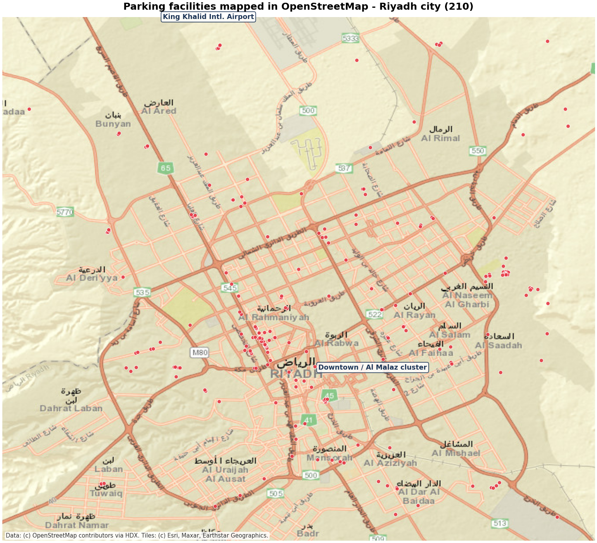

# shadow-parking-detector

This is my parking lot occupancy project. A fixed camera watches some parking spots and the program tells you which spots have cars and which are empty. It shows the result live with green (free) and red (car) boxes and a "Full %" counter.

There are two ways it decides if a spot is taken:

1. If YOLOv8n (a car detector) is installed and it is confident, trust it.
2. Otherwise it compares the spot against a photo of the same spot when it was empty, and uses 3 simple cues:
   - texture loss: empty asphalt looks speckly, a car body is smooth, so if the speckle is gone a car is probably sitting there
   - changed pixels: how many pixels changed vs the empty reference
   - shadow change: cars (and their shadows) change the dark patch pattern

The idea I wanted to test: if a car is half hidden behind a tree or another car, the detector can fail, but the shadow and the missing asphalt texture are still visible. So the fallback cues can still catch those cases.

## How to run it

```
pip install -r requirements.txt

# step 1: draw boxes on the spots (once)
python annotate_spots.py empty.jpg

# step 2: save the empty reference (press R on an EMPTY lot)
python capture.py

# step 3: run the live demo
python main.py
```

No webcam? You can run it on a phone video of a parking lot instead:

```
python annotate_spots.py frame.jpg     # a still from your video
python main.py --video my_lot.mp4
```

## The API version

```
uvicorn api.main:app --reload --port 8000
```

- `GET /health` - status
- `GET /spots` - the spot boxes
- `POST /reference` - upload an empty lot frame (sets the reference)
- `POST /analyze` - upload a frame, get back which spots are occupied as JSON

## Tests

```
pip install pytest httpx
pytest tests/ -v
```

11 tests, they use fake images so no camera or dataset is needed.

## Does it actually work? (honest part)

The whole pipeline works: marking spots, reference capture, live overlay, API. I tested the full loop and the fake-lot tests all pass.

But I want to be honest about accuracy. I ran the no-training cue detector on the public CNRPark+EXT dataset:

| dataset | accuracy |
|---|---|
| CNRPark (oblique cameras) | 61.4% |
| CNR-EXT (top-down cameras) | 40.0% |

So the hand-made cues alone are NOT good enough for real monitoring. Random guessing would be 50%, and on the top-down views my cues actually do worse than random. Interesting detail I found: the cues kind of "flip" between camera angles. From the side, empty asphalt has the texture and the car is smooth. From the top it is the opposite, the car body (windshield, mirrors) carries the texture and empty asphalt looks smooth. That is why no single threshold works for both.

This is exactly why the learned model is the next step. Published CNNs get 97%+ on this same dataset, and my yolo fallback path is there for when you install ultralytics. The point of this repo is the honest baseline + the full working pipeline around it.

One more thing I learned the hard way: the dataset links on cnrpark.it are dead now. The files moved to a github release, `data/download.py` already points at the right place.

## Dataset

```
python data/download.py --small    # quick one, 36.6 MB
python data/download.py            # full CNR-EXT, 449.5 MB
python evaluate.py --data data/raw/CNRPark-Patches-150x150
```

Warning: do not guess CNR-EXT labels from the filename slot number. I checked and it matches the official labels only 49.9% of the time, which is just random. Use the official `all.txt` file (evaluate.py already does).

## Riyadh context

I live in Riyadh and the city just rolled out paid parking (Riyadh Parking, since Aug 2024, 12 districts). Sensors per spot are expensive, one camera covers ~20-40 spots, so a camera-based approach makes sense here.

In `riyadh/` there are 210 real parking facilities in central Riyadh pulled from OpenStreetMap:

- `riyadh_parking.geojson` - click it on github, it renders as a map
- `riyadh_parking_map.png` - static image (below)
- `fetch_parking.py` / `map_parking.py` - re-download and re-render



## Project structure

```
config.py               # all the tunable numbers
main.py                 # live demo with the green/red boxes
annotate_spots.py       # draw the spot boxes
capture.py              # webcam capture + reference saving
evaluate.py             # dataset baseline (no training)
api/main.py             # FastAPI version
detector/               # the actual logic (cues, scoring, spots, yolo)
data/download.py        # dataset downloader
riyadh/                 # the OSM parking data + map
tests/                  # smoke tests
```

## Next steps

- train a small CNN on CNRPark+EXT patches and compare it against my cue baseline per weather condition
- test on the occluded/shadowed subsets specifically, that was the whole motivation
- re-record the empty reference when the sun moves (R key), morning vs afternoon lighting is a real issue here

## Notes

- film only lots you own or have permission for, and keep license plates unreadable
- the YOLO part is optional, everything runs on CPU without it
