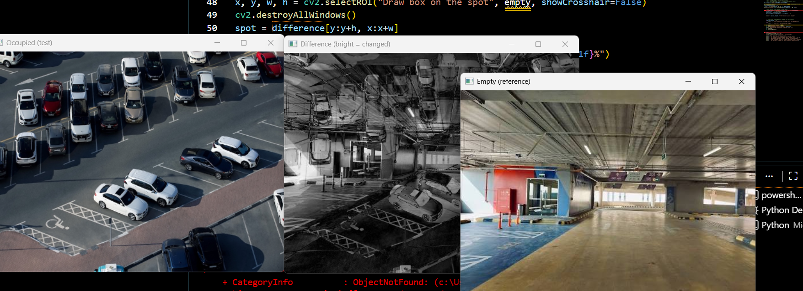
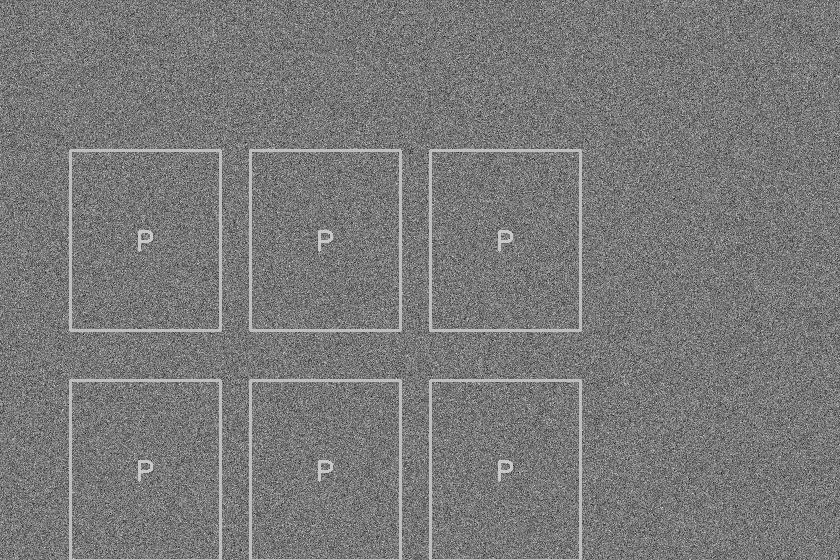
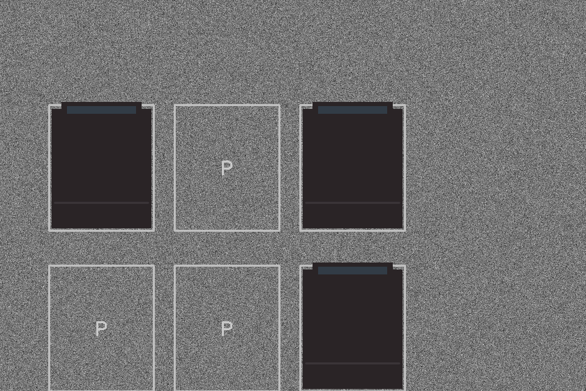
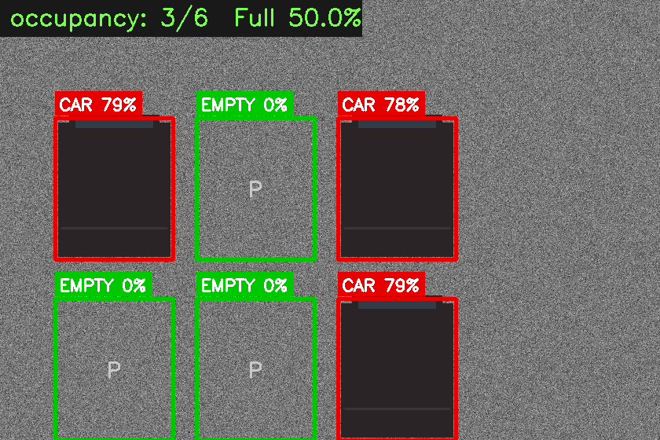
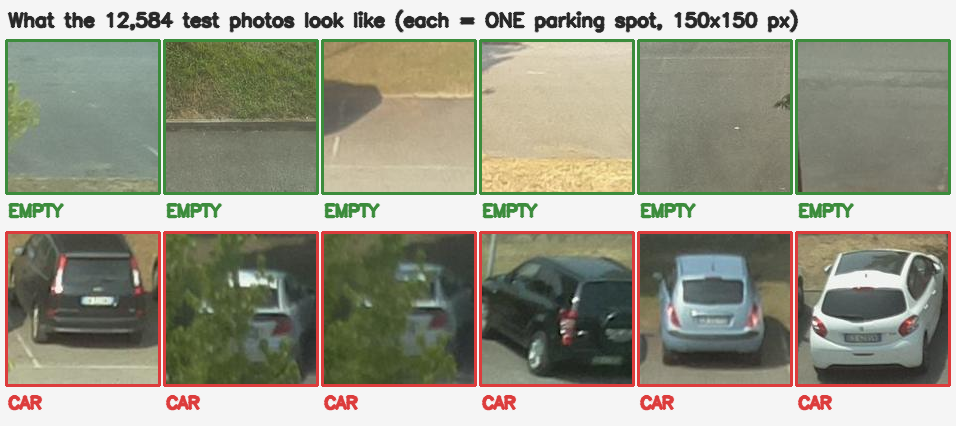

# parking shadow detector

This is my parking occupancy project. The idea is to use a fixed camera to check which parking spaces are taken, then show green boxes for empty spaces, red boxes for occupied ones, and a percentage full.

I wanted to try more than just detecting the car itself. If a car is partly hidden, could changes in its shadow and the visible road surface help tell whether the space is occupied? That is the question behind this project. I still need to test whether those cues actually help in those cases.

## Where I started



This was an early experiment with OpenCV in **2022**: it loads 2 photos, compare their pixels, and select an area to inspect. The empty garage and occupied outdoor lot in this screenshot are different places. Their difference image shows that the scenes are different; it does **not** prove that parking occupancy was detected.

For a useful comparison, both images need to show the same parking spaces from the same camera position and at the same resolution. One is the empty reference, and the other is the image being checked.

I’ve included my original OpenCV scripts, [capture_os.py](early-experiments/capture_os.py) and [parking_test.py](early-experiments/parking_test.py), if you want to see where I started with capturing photos and comparing pixel changes.

## Why Riyadh?

I wanted to give the project some local purpose, so I included a map of parking locations in Riyadh. The current data file contains 210 parking features from OpenStreetMap. These are mapped locations, not live readings from my detector, and they are not a complete list of parking in the city.

[Open the geographic data](riyadh/riyadh_parking.geojson). GitHub can display this file as a map.

Map data: [OpenStreetMap contributors](https://www.openstreetmap.org/copyright), obtained via HDX. The image includes attribution for its basemap. The scripts in `riyadh/` fetch the data and draw the map.

## A simple test lot

Here is a small artificial lot with six spaces. It makes the input and output easier to follow before looking at real camera images.

### 1. Empty reference



This is what the spaces look like before adding any cars.

### 2. Test input



Three spaces now have simulated cars, and three are still empty. The view stays the same so each space can be compared with its reference.

### 3. Result



The result image shows **3 out of 6 spaces occupied, or 50% full**, matching this example. Red means occupied and green means empty. The percentages on individual boxes are detector scores, not measured accuracy or calibrated probabilities.

This is a controlled synthetic example. It helps explain the workflow, but it does not tell me how reliable the detector will be on real footage.

## What the real dataset looks like



These are 12 examples from CNRPark. Each original patch is 150 x 150 pixels and covers one parking space. The top row shows empty spaces; the bottom row shows occupied spaces, including cars partly hidden by trees. The labels describe the dataset examples, not predictions from my detector.

The 12,584 figure in the image refers to the CNRPark evaluation set, not the number of examples shown here. The baseline results are further down.


## How it decides

I mark each parking space with a rectangle first. The program then compares that space with its saved empty reference using three cues:

- **Texture change:** whether the road's texture has become less visible. This is an assumption to test, and it does not hold for every camera angle.
- **Changed pixels:** how much of the space looks different from the reference.
- **Shadow change:** how the dark areas have changed.

These are combined into a score. There is also a simple check to reduce the score when a whole space gets darker but keeps its texture, which could happen when a cloud passes.

YOLOv8n is optional. If it finds a vehicle in a space with enough confidence, the program marks that space occupied. Otherwise, it uses the comparison cues. Those cues run without YOLO or a GPU.

## Running the webcam demo

Run these from the project folder, one at a time:

```powershell
python -m pip install -r requirements.txt
python annotate_spots.py
python capture.py
python main.py
```

1. Keep the camera fixed with a clear view of the spaces.
2. In the marking window, draw one rectangle per parking space and press Enter to accept each one. Press Q to finish; if that does not respond, Esc cancels the next selection and ends the script.
3. In the capture window, make sure all marked spaces are empty, press R to save the reference crops, then Q to close it.
4. Start `main.py` to see the occupancy overlay.

In the live demo, Q quits, D toggles YOLO when available, and R replaces the references. Only press R when the marked spaces are empty.

The current reference saver stacks crops into one NumPy array, so the marked rectangles must have matching pixel dimensions. Supporting differently sized spaces is something I need to fix.

To mark an existing photo instead:

```powershell
python annotate_spots.py "C:\path\to\empty-lot.jpg"
```

That saves the boxes only. It does not create the reference crops. Do not use an unrelated webcam view to capture references for that photo.

### Optional vehicle detector

```powershell
python -m pip install ultralytics
```

The program uses YOLOv8n when available; the weights may download on first use.

### Recorded video

The live script also accepts a video:

```powershell
python main.py --video "C:\path\to\parking.mp4"
```

It still requires matching spot boxes and empty reference crops **before** it starts. Video input currently does not include a complete first-time reference setup. A stationary recording is needed so the boxes stay aligned.

## API

There is a FastAPI backend for uploading images and getting occupancy results as JSON.

```powershell
python -m uvicorn api.main:app --reload --port 8000
```

Open [the API documentation](http://127.0.0.1:8000/docs) to try the endpoints:

| Endpoint | What it does |
|---|---|
| `GET /health` | Shows setup status and whether YOLO is available |
| `GET /spots` | Returns the marked spaces |
| `POST /reference` | Takes an empty image and saves reference crops |
| `POST /analyze` | Takes an image and returns occupancy results |

For the photo workflow, mark the spaces first, upload that same empty photo to `/reference`, then upload a later photo from the same view to `/analyze`. Both uploads use the `frame` field. The matching-crop-size limitation also applies here.

## Results so far

The recorded baseline results for the hand-made cues are:

| Dataset | Accuracy | Images |
|---|---:|---:|
| CNRPark | 61.4% | 12,584 |
| CNR-EXT | 40.0% | 12,000 |

These numbers are for the cue baseline, not a measured result for the combined YOLO system. They are not good enough for reliable parking monitoring.

One possible explanation for the difference is camera angle: a car can hide road texture in one view while adding edges and texture in another. I need more testing before treating that as the full explanation. Detecting partly hidden cars using shadow cues is still an experiment, not a demonstrated result.

### Reproducing the baseline

```powershell
python data/download.py --small
python evaluate.py --data data/raw/CNRPark-Patches-150x150

# Larger dataset
python data/download.py
python evaluate.py --data data/raw/CNR-EXT-Patches-150x150 --limit 300
```

The limited run is a quick check, not a reproduction of the full table. The evaluator uses official CNR-EXT labels rather than guessing labels from filename numbers.

### Tests

```powershell
python -m pip install pytest httpx
python -m pytest tests/ -v
```

The tests use synthetic images. They check parts of the program, but passing them does not establish real-world detection accuracy.

## Files

| File or folder | Purpose |
|---|---|
| `annotate_spots.py` | Mark parking spaces |
| `capture.py` | Capture webcam images and empty references |
| `main.py` | Run the live overlay or video input |
| `config.py` | Paths, thresholds, and scoring weights |
| `detector/` | Image cues, scoring, reference crops, and YOLO helper |
| `api/main.py` | Image upload API |
| `evaluate.py` | Dataset evaluation |
| `data/download.py` | Download the evaluation datasets |
| `riyadh/` | Parking location data and map |
| `docs/images/` | Screenshots used in this README |
| `tests/` | Automated checks |

## What I want to do next

- Fix reference saving for spaces with different rectangle sizes.
- Make photo and video setup easier.
- Record a proper empty/occupied sequence from one fixed camera.
- Compare a small trained classifier with the current cues.
- Test partly hidden cars and changing lighting separately.

For now, this is just a prototype for learning and testing the idea. When collecting footage, I will use locations where I have permission and avoid sharing readable plates.

